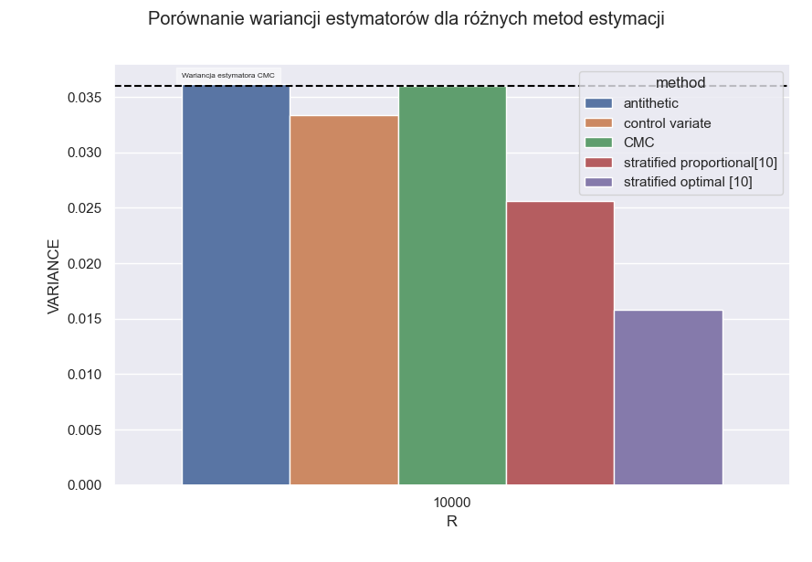
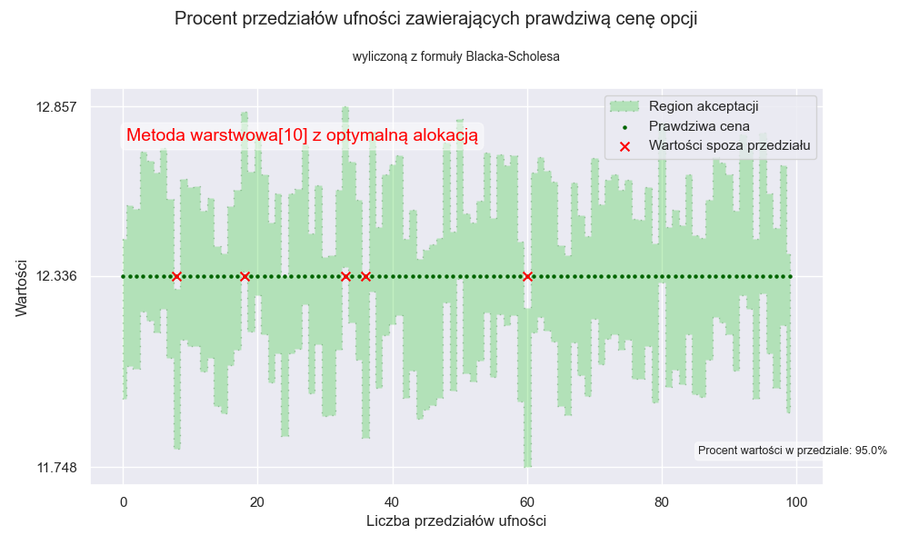

# Variance Reduction for Monte Carlo Option Pricing

**Comparison of crude Monte Carlo, stratified sampling (proportional and optimal allocation), antithetic variates and control variates for European and Asian call options.**


For a fixed simulation budget R, the only way to narrow a Monte Carlo confidence interval is to reduce the variance of the estimator. This project implements the standard variance-reduction techniques. They are tested on an option whose true price is known (a European call, priced with Black–Scholes) and on a path-dependent one with no closed form (an arithmetic **Asian** call with n = 2, 5, 10 averaging dates). The project also asks whether **lower variance actually means a more accurate price**.

**Setup:** GBM with S₀ = 100, K = 100, r = 5%, σ = 25%, T = 1. True European price (Black–Scholes) = **12.336**.

## Results (European call, R = 10,000)

| Method | Estimate | Variance | CI length |
|---|---|---|---|
| Crude Monte Carlo | 12.314 | 0.0360 | 0.00372 |
| Antithetic variates | 12.406 | 0.0361 | 0.00373 |
| Control variate (B₁) | 12.414 | 0.0347 | 0.00358 |
| Stratified, proportional (10 strata) | 12.123 | 0.0256 | 0.00313 |
| **Stratified, optimal (10 strata)** | **12.341** | **0.0158** | **0.00246** |

**Takeaways**
- **Optimal-allocation stratification wins** on every criterion: lowest variance, narrowest intervals and the estimate closest to the true price. Over 100 repeated 95% intervals it hit the target coverage of exactly 95%.
- Lower variance does **not** automatically mean smaller error. As the number of strata grows, the variance keeps falling while the error stays flat, or even grows under optimal allocation.
- Proportional allocation with more strata than R/2 silently needs a larger budget than R. The project derives this and restricts the strata count accordingly.
- For Asian options, optimal allocation reduced the variance by **about 3 orders of magnitude** compared with proportional allocation in one of the tested set-ups.
- The antithetic estimator using pairs (Z, −Z) gave no gain here. This points to choosing the dependent variables more carefully.

<p align="center">
  
  
</p>
<p align="center"><em>Left: estimator variance by method (R = 10,000). Right: 100 confidence intervals from the optimal stratified estimator against the Black–Scholes price.</em></p>

## Repository structure

```
src/variance_reduction/   pricing (GBM, Black–Scholes, crude MC), stratification,
                          antithetic, control_variate
scripts/                  analysis, comparison_plots
reports/                  full report (PDF, in Polish)
```

## How to run

```bash
python -m pip install -e .        # pins numpy<2
python -m scripts.analysis
python -m scripts.comparison_plots
```

Unit tests (Black–Scholes reference value, reproducibility of seeded estimators): `python -m unittest discover -s tests`.

## Report

📄 [Full report (PDF, Polish, 21 pages)](reports/Redukcja-wariancji-Adamek-Karawan-Fina%C5%82.pdf)

**Authors:** Paulina Adamek, Maciej Karawan. Introduction to Simulation and Monte Carlo Methods course project, January 2024.
